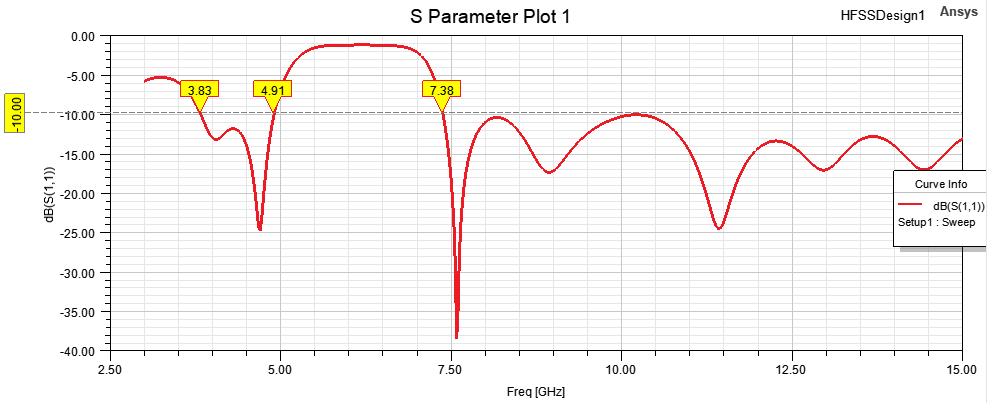
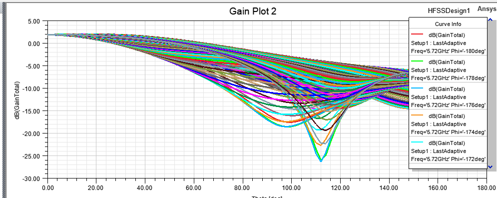

# Filtering antenna with a 4.9 to 7.4 GHz stop band (HFSS)

An Ansys HFSS model of a filtering (band-notched) antenna for C-band applications, built on an FR4 epoxy substrate. A microstrip feed line with two short stubs ends in a half-circular patch, and a vertical conducting plate sits at the feed end. The antenna is designed to reject 4.9 to 7.4 GHz and work on either side of that band.

*3D model in the HFSS modeler.*

## Results

*dB(S(1,1)) from the frequency sweep. The three markers sit where the curve crosses the −10 dB line.*

| Feature | Value |
|---|---|
| Frequency range plotted | 3 to 15 GHz |
| Lower operating band (S11 below −10 dB) | 3.83 to 4.91 GHz (1.08 GHz wide, about 25 % fractional bandwidth) |
| Stop band | 4.91 to 7.38 GHz, S11 about −1 dB at its flattest |
| Upper operating band | from 7.38 GHz to 15 GHz, the end of the sweep; S11 is near or below −10 dB and rises back to about −10 dB near 10 GHz |
| Deepest matches | about −24.5 dB near 4.7 GHz and about −38 dB near 7.55 GHz |

An S11 of about −1 dB means most of the input power is reflected, so the antenna accepts little power across the stop band. The three band edges (3.83, 4.91 and 7.38 GHz) are the marker values. The other levels are read by eye from the curve and are approximate.

All results are simulated in HFSS. They are not measurements. The S11 plot and two gain plots are included. Realized gain across frequency is not.

## Radiation pattern

*3D total gain pattern from HFSS (Gain Plot 1). The scale is linear, with a peak gain of 1.58 (about 2.0 dBi).*

*dB(GainTotal) against theta for Phi cuts from −180° to 180° at 5.72 GHz (Setup1, LastAdaptive). Gain is about 2 dB at theta = 0° and falls with theta, reaching about −26 dB at its deepest near 112°. Values are read by eye.*

5.72 GHz is inside the 4.9 to 7.38 GHz stop band. HFSS total gain is relative to the power the antenna accepts and does not include mismatch loss, so these curves do not show the stop-band rejection. The S11 plot does: S11 is about −1 dB at this frequency, so most of the input power is reflected before it can radiate.

## Model

| Part | Material |
|---|---|
| Substrate | FR4 epoxy |
| Conductor (feed line, stubs, patch, end plate) | PEC |
| Surrounding region | Vacuum |

## Simulation setup

- Software: Ansys Electronics Desktop 2022 R1, HFSS
- Design: `HFSSDesign1`, solution type Modal Network
- Analysis: `Setup1` with a frequency sweep
- Result: `S Parameter Plot 1`, dB(S(1,1))

## Project files

- `BSFA1`: Ansys Electronics Desktop project containing `HFSSDesign1`
- `hfss_model.png`: 3D model
- `s11_plot.png`: S11 plot
- `gain_plot.png`: 3D total gain pattern
- `gain_plot_5p72ghz.png`: gain against theta at 5.72 GHz

To reproduce the plot, open `BSFA1` in Ansys Electronics Desktop, select `HFSSDesign1`, run `Setup1`, and open `S Parameter Plot 1` under Results.

## Requirements

- Ansys Electronics Desktop 2022 R1 or newer with HFSS

## Author

Michael Antwi, Telecommunication Engineering, KNUST
