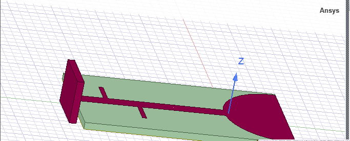

# BSFA1: microstrip structure on FR4 in HFSS

An Ansys HFSS model of a planar microstrip structure on an FR4 epoxy substrate. A feed line with two short stubs ends in a half-circular patch, and a vertical conducting plate sits at the feed end. The S11 response over 3 to 15 GHz is below −10 dB from 3.83 to 4.91 GHz and above 7.38 GHz, and close to 0 dB between 4.91 and 7.38 GHz.

*3D model in the HFSS modeler.*

## Results

*dB(S(1,1)) from the frequency sweep. The three markers sit where the curve crosses the −10 dB line.*

| Feature | Value |
|---|---|
| Frequency range plotted | 3 to 15 GHz |
| S11 below −10 dB, lower band | 3.83 to 4.91 GHz (1.08 GHz wide, about 25 % fractional bandwidth) |
| Reflection band | 4.91 to 7.38 GHz, S11 about −1 dB at its flattest |
| S11 below −10 dB, upper band | from 7.38 GHz upward, rising back to about −10 dB near 10 GHz |
| Deepest minima | about −24.5 dB near 4.7 GHz and about −38 dB near 7.55 GHz |

The three band edges (3.83, 4.91 and 7.38 GHz) are the marker values. The minima and other levels are read by eye from the curve and are approximate.

All results are simulated in HFSS. They are not measurements.

## Model

| Part | Material |
|---|---|
| Substrate | FR4 epoxy |
| Conductor (feed line, stubs, patch, end plate) | PEC |
| Surrounding region | Vacuum |

## Simulation setup

- Software: Ansys Electronics Desktop 2022 R1, HFSS
- Design: `HFSSDesign1`, solution type Modal Network
- Analysis: `Setup1` with a frequency sweep
- Result: `S Parameter Plot 1`, dB(S(1,1))

## Project files

- `BSFA1`: Ansys Electronics Desktop project containing `HFSSDesign1`
- `hfss_model.png`: 3D model
- `s11_plot.png`: S11 plot

To reproduce the plot, open `BSFA1` in Ansys Electronics Desktop, select `HFSSDesign1`, run `Setup1`, and open `S Parameter Plot 1` under Results.

## Requirements

- Ansys Electronics Desktop 2022 R1 or newer with HFSS

## Author

Michael Antwi, Telecommunication Engineering, KNUST
